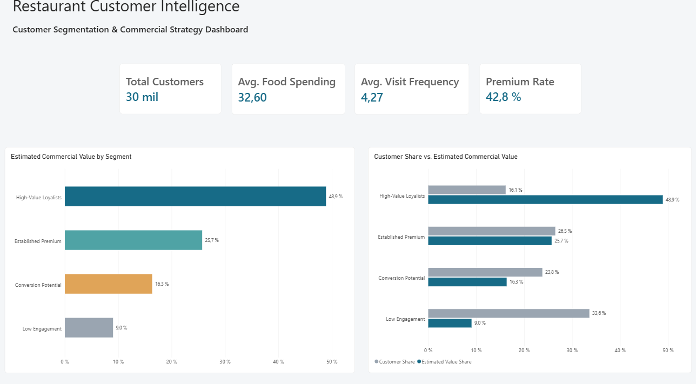
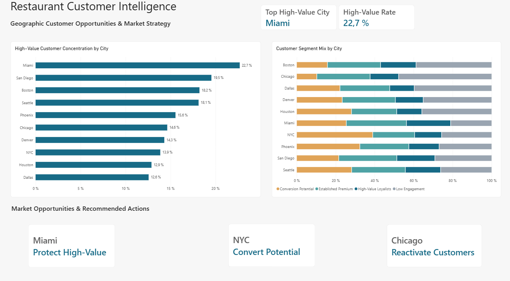

# Restaurant Customer Intelligence

End-to-end customer analytics project for a multi-city restaurant business, focused on transforming customer data into actionable commercial strategies.

The project covers the complete analytical workflow: **data quality, exploratory analysis, feature engineering, customer segmentation, geographic analysis, and business strategy development**.

## Business Objective

Restaurant businesses often have large customer databases but limited insight into how different customer groups contribute to the business.

This project explores how customer analytics can help answer questions such as:

- Who are the most valuable customers?
- Which customers have the greatest conversion potential?
- Which segments should receive retention or reactivation campaigns?
- How do customer profiles differ across cities?
- Where should commercial resources be prioritized?

The objective is not only to identify customer segments, but to translate them into **measurable and actionable business strategies**.

---

## Dataset

The analysis uses a multi-city customer dataset containing **30,000 customers across 10 U.S. cities**.

The dataset includes information such as:

- age and gender
- city of residence
- socioeconomic level
- visit frequency
- average food spending
- monthly income
- Premium membership
- food preferences
- alcohol consumption
- preferred payment method

Customer identifiers and contact information are retained for data-quality analysis but are not used as segmentation features.

---

## Project Workflow

### 01 — Data Quality

The first stage evaluates the reliability of the customer dataset.

Main tasks include:

- duplicate detection
- missing-value analysis
- invalid age detection
- invalid visit-frequency detection
- spending validation
- customer identifier validation
- contact-data completeness analysis

Invalid values are converted to missing values rather than artificially corrected when the true value cannot be inferred.

---

### 02 — Multi-City Exploratory Data Analysis

Customer behavior is analyzed across the 10 markets to identify geographic differences.

Key findings include:

- **Miami** has the highest average food spending.
- **Seattle** has the highest proportion of high spenders.
- **New York City** combines high spending with relatively low Premium penetration.
- Customer behavior varies substantially across markets, suggesting that a single commercial strategy would not be optimal for every city.

The analysis also explores food preferences, Premium membership, income, visit frequency, and socioeconomic differences across cities.

---

### 03 — Feature Engineering

New analytical variables are created to improve customer profiling and segmentation.

Engineered features include:

- age groups
- Premium membership flag
- spending-to-income ratio

The analysis also evaluates relationships between:

- spending and income
- visit frequency and spending
- Premium membership and socioeconomic level
- customer behavior and income

These features provide the foundation for the segmentation model.

---

### 04 — Customer Segmentation

Customer segments are created using **K-Means clustering**.

The model uses:

- age
- visit frequency
- average food spending
- monthly income
- Premium membership
- spending-to-income ratio

Missing numerical values are handled using median imputation, followed by feature scaling.

Several cluster solutions are evaluated using silhouette scores together with business interpretability and segment size.

A **4-cluster solution** is selected as the best balance between statistical structure and commercial actionability.

### Final Customer Segments

#### High-Value Loyalists

Customers with the highest visit frequency, spending, income, and very high Premium membership.

**Business priority:** protect customer value through VIP retention strategies.

#### Established Premium

A strong Premium customer base with consistent spending and engagement.

**Business priority:** maintain loyalty and Premium retention.

#### Conversion Potential

Customers with meaningful spending but relatively low Premium penetration.

**Business priority:** increase engagement and Premium conversion.

#### Low Engagement

The largest customer segment, characterized by lower visit frequency and spending.

**Business priority:** scalable, cost-efficient reactivation.

---

## Key Business Findings

Customer volume and estimated commercial value are not distributed equally.

**High-Value Loyalists represent only 16.1% of customers but account for approximately 48.9% of the estimated commercial value proxy.**

By contrast, **Low Engagement represents 33.6% of customers but approximately 9.0% of estimated value.**

Established Premium represents approximately **26.5% of customers and 25.7% of estimated value**, while Conversion Potential represents approximately **23.8% of customers and 16.4% of estimated value**.

This suggests that customer strategy should prioritize **value protection, conversion, and cost-efficient activation differently across segments**.

> **Methodological note:** Estimated commercial value is a relative proxy calculated at the customer level as visit frequency × average food spending. It should not be interpreted as actual revenue, sales, or Customer Lifetime Value (CLV). Because of missing visit-frequency or spending information, the proxy is available for approximately 94–96% of customers across segments.

---

## Geographic Strategy

Customer segment concentration varies significantly by city.

Examples include:

- **Miami** — strong concentration of High-Value Loyalists
- **New York City** — strong Conversion Potential
- **Chicago** — strong concentration of Low Engagement customers
- **Phoenix** — notable Conversion Potential
- **San Diego** — above-average concentration of High-Value Loyalists

These differences allow commercial strategies to be adapted to each market rather than applying the same campaign everywhere.

Geographic affinity is used as a **relative concentration indicator**, not as evidence of causality.

---

## Recommended Customer Strategies

| Segment | Business Objective | Recommended Strategy |
|---|---|---|
| High-Value Loyalists | Protect customer value | VIP experiences, exclusive benefits and personalized retention |
| Established Premium | Retain Premium customers | Loyalty rewards, personalized offers and exclusive benefits |
| Conversion Potential | Increase Premium adoption | Premium trials, targeted membership offers and bundled benefits |
| Low Engagement | Increase engagement | Reactivation campaigns and cost-efficient visit incentives |

The strategy framework also defines measurable KPIs and proposes controlled experiments for evaluating whether each intervention produces incremental business impact.

---

## Experimentation Framework

The project proposes test-and-control experiments for each customer segment.

Examples include:

- VIP retention benefits
- enhanced Premium loyalty benefits
- targeted Premium membership offers
- return-visit incentives

Potential KPIs include:

- retention rate
- Premium retention rate
- Premium conversion rate
- repeat visit rate
- visit frequency

The current dataset does not contain campaign outcomes, so these experiments represent a **measurement framework rather than simulated or claimed campaign results**.

---

## Project Structure

```text
restaurant-customer-intelligence/
│
├── app/
├── dashboard/
├── data/
│   ├── raw/
│   └── processed/
│
├── notebooks/
│   ├── 01_data_quality.ipynb
│   ├── 02_eda_multicity.ipynb
│   ├── 03_feature_engineering.ipynb
│   ├── 04_customer_segmentation.ipynb
│   └── 05_customer_strategy.ipynb
│
├── reports/
├── src/
├── .gitignore
└── README.md
```

Processed analytical datasets are excluded from version control.

---

## Tools & Technologies

- Python
- Pandas
- NumPy
- Matplotlib
- Scikit-learn
- Jupyter Notebook
- VS Code
- Git
- GitHub
- Power BI
- DAX

Analytical techniques include:

- exploratory data analysis
- data-quality assessment
- feature engineering
- missing-value imputation
- feature scaling
- K-Means clustering
- silhouette analysis
- customer profiling
- geographic affinity analysis
- business KPI development
- experimental design

---

## Power BI Dashboard

The final stage of the project translates the customer segmentation analysis into an interactive business intelligence dashboard designed for commercial decision-making.

The dashboard was developed in **Power BI** using the final segmented customer dataset and consists of two analytical views.

### Executive Overview

The Executive Overview provides a high-level view of customer behavior and the commercial importance of each segment.



Key metrics include:

- **30,000 customers**
- **32.60 average food spending**
- **4.27 average visit frequency**
- **42.8% Premium membership rate**

The dashboard also compares each segment's share of customers with its estimated share of commercial value.

The **High-Value Loyalists** segment represents only **16.1% of customers**, but contributes approximately **48.9% of the estimated commercial value**, highlighting the importance of retention and value-protection strategies.

> **Methodological note:** Estimated Commercial Value is a relative analytical proxy calculated at customer level as visit frequency × average food spending. It should not be interpreted as actual revenue, sales, or Customer Lifetime Value.

### Geographic Strategy

The Geographic Strategy view extends the segmentation analysis to the city level.



The dashboard highlights geographic differences in customer composition and identifies market-specific opportunities.

Key findings include:

- **Miami** has the highest concentration of High-Value Loyalists at **22.7%**, supporting a strategy focused on protecting and retaining high-value customers.
- **NYC** shows a strong concentration of Conversion Potential customers, suggesting opportunities for Premium conversion and engagement strategies.
- **Chicago** has a comparatively strong Low Engagement presence, supporting customer reactivation and frequency-growth initiatives.

These findings are translated directly into three recommended market actions:

- **Miami — Protect High-Value**
- **NYC — Convert Potential**
- **Chicago — Reactivate Customers**

The interactive Power BI report is available at:

`dashboard/restaurant_customer_intelligence.pbix`

---

## Business Applications

The analytical framework developed in this project could support restaurant businesses in:

- customer segmentation
- loyalty-program optimization
- Premium membership conversion
- customer retention
- reactivation campaigns
- geographic campaign targeting
- marketing resource allocation
- customer intelligence dashboards

With transactional and longitudinal restaurant data, the framework could be extended to include **Customer Lifetime Value, churn prediction, campaign response modeling, recommendation systems, and real-time customer targeting**.

---

## Next Steps

Future development of the project could extend the current customer intelligence framework through:

- integration of transactional and longitudinal restaurant data
- Customer Lifetime Value modeling
- churn and retention prediction
- campaign response modeling
- recommendation systems
- automated customer strategy recommendations
- interactive filtering and drill-down analysis
- deployment of the analytical workflow for real restaurant data
- development of a local market intelligence layer using restaurant data from specific markets

Data Analytics & Data Science Portfolio Project